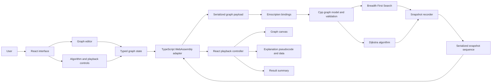
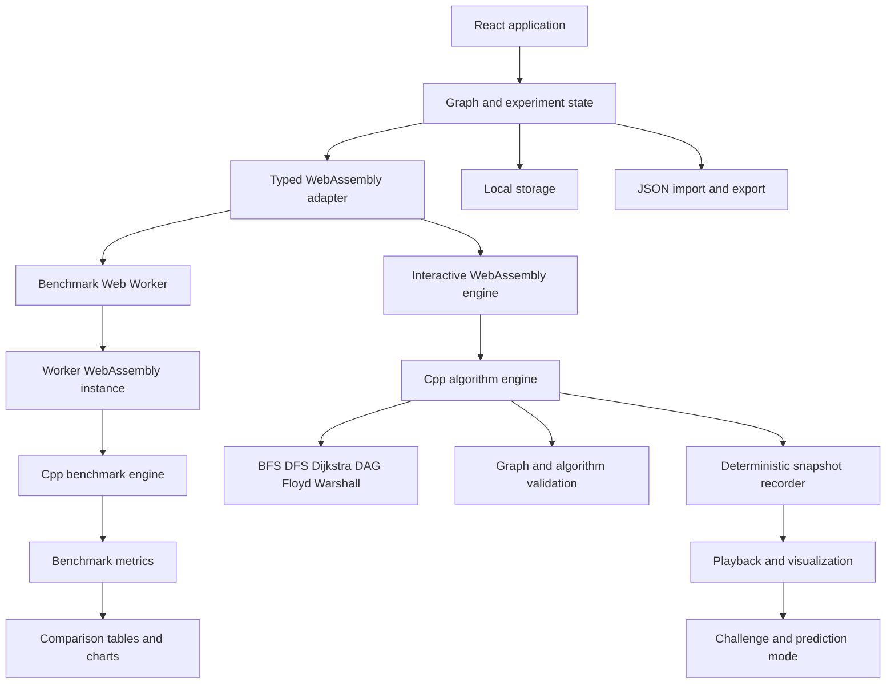
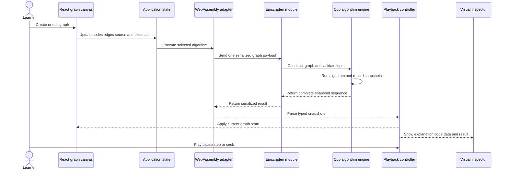
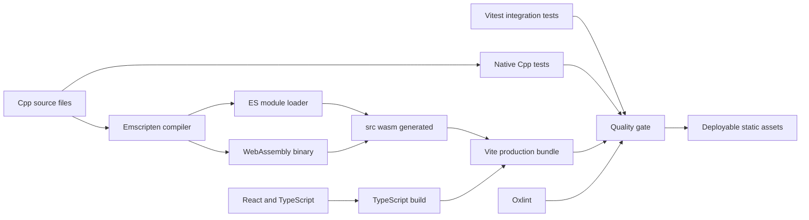

# PathScope

PathScope is a browser-based graph algorithm visualizer built for the Design and Analysis of Algorithms curriculum. It allows a learner to create a graph, select an algorithm, and replay every algorithmic decision as a synchronized sequence of graph states, data-structure updates, pseudocode lines, and result metrics.

The project uses C++17 for algorithm execution and compiles that code to WebAssembly with Emscripten. React and TypeScript are responsible for the interface, graph editing, playback, and presentation. Algorithm decisions are not duplicated in the frontend.

This repository currently represents the working 50 percent milestone. The final 100 percent scope is documented separately in this README so that implemented features and planned features are never confused.

## Table of contents

1. [Project status](#project-status)
2. [Problem statement](#problem-statement)
3. [Project objectives](#project-objectives)
4. [Current 50 percent milestone](#current-50-percent-milestone)
5. [Final 100 percent scope](#final-100-percent-scope)
6. [Scope comparison](#scope-comparison)
7. [System architecture](#system-architecture)
8. [Runtime execution pipeline](#runtime-execution-pipeline)
9. [Build and delivery pipeline](#build-and-delivery-pipeline)
10. [Algorithm design](#algorithm-design)
11. [Technology stack](#technology-stack)
12. [Application routes](#application-routes)
13. [Repository structure](#repository-structure)
14. [Data contracts](#data-contracts)
15. [Installation and local development](#installation-and-local-development)
16. [Testing strategy](#testing-strategy)
17. [Quality attributes](#quality-attributes)
18. [Known limitations](#known-limitations)
19. [Roadmap](#roadmap)
20. [Definition of completion](#definition-of-completion)

## Project status

| Item | Status |
| --- | --- |
| Project phase | Phase 1, working 50 percent milestone |
| Implemented algorithms | Breadth-First Search and Dijkstra's algorithm |
| Algorithm runtime | C++17 compiled to WebAssembly |
| Frontend | React 19 and TypeScript |
| Graph interface | Interactive undirected weighted graph editor |
| Automated verification | 25 native C++ tests, 31 Vitest tests, and 10 real-browser Playwright E2E tests |
| Final project scope | Defined in the 100 percent scope section |

The milestone is intentionally limited. Only functionality that is implemented, tested, and exposed in the interface is described as complete.

## Problem statement

Graph algorithms are commonly taught through pseudocode, mathematical analysis, and fixed examples. This approach explains what an algorithm should do but often does not show why a particular vertex is selected, why a distance changes, or how the underlying data structure controls execution.

Existing visualizers frequently have one or more of the following limitations:

- They provide only fixed graphs.
- They animate a result without exposing the intermediate algorithm state.
- Their algorithm code is coupled directly to UI state.
- They do not synchronize graph changes with pseudocode and data structures.
- They make it difficult to compare minimum-hop and minimum-weight paths on the same graph.

PathScope addresses these limitations by treating each algorithm execution as a deterministic sequence of immutable snapshots. Every snapshot contains the information needed to explain and replay one logical step.

## Project objectives

PathScope is designed to meet the following objectives:

1. Make graph algorithms observable rather than presenting only their final output.
2. Keep the algorithm engine independent from the user interface.
3. Execute core graph logic in C++ for alignment with DAA coursework.
4. Use WebAssembly to preserve a browser-only deployment model.
5. Synchronize graph states, pseudocode, data structures, and explanations.
6. Support repeatable comparisons on identical graph inputs.
7. Validate algorithm constraints before or during execution.
8. Maintain an explicit distinction between completed milestone work and future scope.

## Current 50 percent milestone

The current milestone establishes the complete vertical path from graph input to C++ execution and visual playback. It contains two fully working algorithms and the shared platform required for additional algorithms in Phase 2.

### 1. C++ algorithm engine

The current engine includes:

- A reusable graph model with node, edge, adjacency, and lookup structures.
- Deterministic neighbor ordering for reproducible playback.
- Breadth-First Search using `std::queue`.
- Dijkstra's algorithm using `std::priority_queue` as a min-heap.
- Path reconstruction through predecessor relationships.
- Input and algorithm constraint validation.
- Snapshot recording for every meaningful execution step.
- JSON serialization for the WebAssembly boundary.

All traversal, relaxation, priority-queue, predecessor, and path-reconstruction decisions are executed in C++.

### 2. WebAssembly integration

The C++ engine is compiled with Emscripten and exposed through two functions:

```text
run_bfs_wasm(inputJson)
run_dijkstra_wasm(inputJson)
```

The frontend sends one complete graph payload to the selected function. C++ runs the algorithm to completion and returns one serialized snapshot sequence. The browser does not call into C++ separately for every vertex or edge.

### 3. Interactive graph editor

The current editor supports:

- Adding vertices.
- Dragging and repositioning vertices.
- Connecting vertices with undirected edges.
- Selecting a start vertex and a destination vertex.
- Editing non-negative edge weights.
- Deleting graph elements.
- Resetting the viewport and visualization state.
- Loading curated graph presets.
- Visual state changes for current, frontier, visited, and final-path elements.

### 4. Step-by-step playback

Each C++ snapshot can be replayed through:

- Play and pause.
- Previous and next step.
- Restart.
- Timeline seeking.
- Adjustable playback speed.
- Current-step and total-step indicators.

Playback does not rerun the algorithm. It navigates the immutable snapshot sequence returned by WebAssembly.

### 5. Synchronized inspector

The inspector presents algorithm state through four views:

- Explanation: a plain-language description of the current operation.
- Pseudocode: the active pseudocode line for the current snapshot.
- Data: queue, priority queue, distances, predecessors, and traversal state.
- Result: final path, cost, hop count, explored vertices, and complexity information.

### 6. Algorithm comparison

The comparison view runs BFS and Dijkstra on the same topology and reports:

- Resulting path.
- Hop count.
- Total numeric path cost.
- Number of explored vertices.
- Number of generated snapshots.
- Time complexity.
- Space complexity.
- Correctness guarantee.

The primary educational comparison is:

- BFS minimizes the number of edges in an unweighted interpretation.
- Dijkstra minimizes total edge weight when every edge weight is non-negative.

### 7. User interface and accessibility foundation

The current interface includes:

- Warm beige light mode.
- Neutral charcoal dark mode.
- Inter for interface text.
- JetBrains Mono for code and technical values.
- Responsive desktop, tablet, and mobile layouts.
- Semantic theme tokens.
- Keyboard and focus states for interactive controls.
- Color, border, and label differences for graph states.

### 8. Current presets

The current milestone includes focused examples for:

- BFS versus Dijkstra path tradeoffs.
- A standard non-negative weighted graph.
- An unreachable destination in a disconnected graph.

### 9. Current automated verification

The test suite currently contains:

- 11 native C++ algorithm tests.
- 19 Vitest frontend and integration tests.
- TypeScript checking during the production build.
- Oxlint static analysis.
- A complete C++ to WebAssembly production build.

## Final 100 percent scope

The 100 percent version completes the original five-algorithm educational platform and the remaining learning, persistence, benchmarking, and verification features.

### 1. Complete syllabus algorithm set

The final product will contain five algorithms:

| Algorithm | Final purpose | Required visualization |
| --- | --- | --- |
| Breadth-First Search | Minimum-hop paths in unweighted graphs | FIFO queue, levels, visited set, predecessor map |
| Depth-First Search | Traversal, reachability, and backtracking | LIFO stack, discovery order, backtracking path |
| Dijkstra's algorithm | Minimum-weight path with non-negative weights | Min-heap, relaxations, distance and predecessor tables |
| DAG shortest path | Linear-time shortest paths in directed acyclic graphs | Topological order, cycle validation, ordered relaxations |
| Floyd-Warshall | All-pairs shortest paths | Distance matrix, intermediate vertex, updated matrix cell |

The three Phase 2 algorithms will also be implemented in C++ and exposed through the same WebAssembly adapter pattern.

### 2. Directed and specialized graph support

The final graph model will add:

- Directed and undirected graph modes.
- Directional edge rendering.
- Negative-weight support where the selected algorithm permits it.
- DAG cycle validation.
- Dense graph and matrix-oriented presets.
- Algorithm-specific input compatibility checks.

### 3. Expanded comparison suite

The final comparison system will support compatible algorithm groups rather than running invalid algorithms on unsuitable graphs.

It will compare:

- Path and traversal results.
- Hop count and weighted cost.
- Explored vertices.
- Relaxation or inspection counts.
- Snapshot counts.
- Observed execution time.
- Theoretical time and space bounds.
- Algorithm preconditions and correctness guarantees.

### 4. Graph generation and experiments

The final version will include deterministic generators for:

- Sparse graphs.
- Dense graphs.
- Connected and disconnected graphs.
- DAGs.
- Best-case patterns.
- Average-case patterns.
- Worst-case teaching patterns.

Generated graphs will be reproducible through a stored seed.

### 5. Challenge and prediction mode

Challenge mode will allow students to predict:

- The next visited vertex.
- The next queue or stack operation.
- The next extracted priority-queue element.
- Whether an edge will be relaxed.
- The next Floyd-Warshall matrix update.

The system will explain incorrect predictions before revealing the correct snapshot.

### 6. Persistence and graph exchange

The final version will support:

- JSON graph import.
- JSON graph export.
- Local project persistence with browser storage.
- Versioned graph-file validation.
- Recovery from invalid or unsupported files.

No account or server database is required for the defined final scope.

### 7. Background benchmarking

Large comparison runs will move to Web Workers so that benchmark execution does not block graph interaction or animation.

The final benchmark pipeline will separate:

- Interactive snapshot generation.
- Repeated performance measurement.
- UI rendering.

### 8. Charts and experiment reporting

The final comparison page will add focused charts for:

- Graph size versus operations.
- Graph density versus execution time.
- Algorithm step counts.
- Memory or state-size estimates.

Charts will support the analysis and will not replace the underlying numeric table.

### 9. Complete verification strategy

The final test system will add:

- Native C++ tests for DFS, DAG shortest path, and Floyd-Warshall.
- Negative-cycle and cycle-validation tests.
- WebAssembly contract tests for all five algorithms.
- Browser workflow tests with Playwright.
- Keyboard-navigation tests.
- Responsive-layout checks.
- Accessibility checks.
- Import and export round-trip tests.

### 10. Deployment and release readiness

The final release will include:

- A reproducible continuous-integration workflow.
- Automated test, lint, typecheck, and production-build gates.
- Static deployment to GitHub Pages or Vercel.
- Cache policy for versioned WebAssembly assets.
- Release notes and a final demonstration dataset.

## Scope comparison

| Capability | Current 50 percent milestone | Final 100 percent product |
| --- | --- | --- |
| Algorithms | BFS and Dijkstra | BFS, DFS, Dijkstra, DAG shortest path, Floyd-Warshall |
| Algorithm language | C++17 | C++17 |
| Browser integration | Emscripten WebAssembly | Emscripten WebAssembly |
| Graph types | Undirected weighted and unweighted interpretation | Directed, undirected, weighted, unweighted, DAG, and dense graphs |
| Graph editing | Add, move, connect, delete, edit weights | Current editor plus direction and algorithm-specific validation |
| Playback | Full snapshot playback | Full playback for all five algorithms |
| Data structures | FIFO queue and min-heap | Queue, stack, min-heap, topological order, and distance matrix |
| Comparison | BFS versus Dijkstra | Compatible multi-algorithm comparison |
| Presets | Three focused examples | At least six syllabus-aligned examples |
| Graph generation | Not included | Sparse, dense, DAG, disconnected, and complexity-pattern generators |
| Challenge mode | Not included | Prediction and guided feedback |
| Import and export | Not included | Versioned JSON import and export |
| Persistence | Session memory | Browser local storage |
| Background processing | Main browser thread | Web Workers for benchmark workloads |
| Charts | Numeric comparison | Numeric comparison plus focused benchmark charts |
| Testing | C++, Vitest, lint, typecheck, build | Current checks plus full algorithm, browser, accessibility, and workflow coverage |
| Deployment | Local production build | Automated static deployment and release workflow |

## System architecture

### Architectural principles

The project follows these principles:

1. The C++ engine is the source of truth for algorithm decisions.
2. The TypeScript boundary is small, typed, and algorithm-independent.
3. A complete execution crosses the JavaScript and WebAssembly boundary only once in each direction.
4. Snapshots are immutable after creation.
5. Playback is separate from algorithm execution.
6. The application remains browser-only and requires no backend service.
7. Algorithm-specific validation is performed close to the algorithm engine.

### Current runtime architecture



### Final 100 percent architecture



### Component responsibilities

| Layer | Responsibility |
| --- | --- |
| React pages | Route-level layout and feature composition |
| React components | Graph editing, controls, inspection, results, and responsive UI |
| Playback hook | Snapshot selection, autoplay timing, seeking, and reset behavior |
| TypeScript data contracts | Compile-time agreement between UI and WebAssembly output |
| WebAssembly adapter | Module loading, payload formatting, function dispatch, and result parsing |
| Emscripten bindings | Expose C++ entry points and serialize results |
| C++ graph model | Graph construction, adjacency data, lookup, and deterministic ordering |
| C++ algorithms | Traversal, relaxation, validation, and path reconstruction |
| Snapshot recorder | Store every observable algorithm transition |
| Test layers | Verify algorithm correctness, boundary behavior, and UI integration |

## Runtime execution pipeline

The application executes an algorithm through the following sequence:



### Input payload

The TypeScript adapter sends a payload with this logical structure:

```json
{
  "nodes": [
    { "id": "A", "label": "A" }
  ],
  "edges": [
    { "id": "A-B", "source": "A", "target": "B", "weight": 4 }
  ],
  "isDirected": false,
  "sourceId": "A",
  "targetId": "D"
}
```

### Output snapshot sequence

Each returned snapshot can contain:

- Step number.
- Active pseudocode line.
- Human-readable explanation.
- Current vertex and edge.
- Visited vertices and edges.
- Frontier vertices.
- Current queue or priority queue.
- Distance table.
- Predecessor table.
- Traversal order.
- Reconstructed path.
- Status, total cost, and hop count.

The UI renders this data but does not recalculate it.

## Build and delivery pipeline

### Local build pipeline



### Intended continuous-integration pipeline for the final release

```text
Checkout
  -> install Node dependencies
  -> activate Emscripten
  -> compile and run native C++ tests
  -> compile C++ to WebAssembly
  -> run Vitest tests
  -> run lint and TypeScript checks
  -> build production assets
  -> run browser and accessibility tests
  -> publish versioned static assets
```

## Algorithm design

### Breadth-First Search

Purpose:

- Traverse an unweighted graph level by level.
- Find a path containing the minimum number of edges.

Core data structures:

- FIFO queue.
- Visited set.
- Predecessor map.
- Hop-distance map.

Complexity:

- Time: O(V + E).
- Auxiliary space: O(V).

Important behavior:

- Numeric edge weights do not influence BFS decisions.
- A vertex is marked when discovered to avoid repeated insertion.
- The predecessor map reconstructs the final path.
- Disconnected destinations return an unreachable result.

### Dijkstra's algorithm

Purpose:

- Find the minimum-total-weight path from a source to a destination.

Core data structures:

- Adjacency list.
- Binary min-heap priority queue.
- Tentative-distance map.
- Predecessor map.
- Settled or visited set.

Complexity:

- Time: O((V + E) log V).
- Practical storage: O(V + E), including the graph representation and algorithm state.

Important behavior:

- All edge weights must be non-negative.
- Relaxation updates a distance only when a lower-cost path is found.
- Stale priority-queue entries are skipped.
- The predecessor map reconstructs the optimal path.
- Invalid negative-weight input returns an invalid result instead of a misleading path.

## Technology stack

| Area | Technology | Role in the project |
| --- | --- | --- |
| Algorithm language | C++17 | Graph representation, validation, BFS, Dijkstra, path reconstruction, snapshots |
| Browser compilation | Emscripten and Embind | Compile C++ into WebAssembly and expose typed entry points |
| WebAssembly runtime | Browser WebAssembly | Execute the C++ algorithm engine locally in the browser |
| UI framework | React 19 | Component model, application state, and rendering |
| Frontend language | TypeScript 6 | Typed graph contracts, adapter, playback, and interface logic |
| Build tool | Vite 8 | Development server, module transformation, and production bundling |
| Styling | Tailwind CSS 4 and CSS variables | Responsive layouts and semantic theming |
| Graph canvas | React Flow from `@xyflow/react` | Node and edge editing, viewport controls, and custom graph rendering |
| Icons | Lucide React | Consistent interface icons |
| Interface fonts | Instrument Sans Variable and Manrope Variable | Navigation, headings, body text, and controls |
| Technical font | JetBrains Mono Variable | Pseudocode, weights, distances, and complexity notation |
| Frontend tests | Vitest | TypeScript, adapter, and integration verification |
| E2E tests | Playwright | Real-browser accessibility, responsive, and playback verification |
| Native tests | C++ test executable | Direct algorithm correctness verification without the browser |
| Static analysis | Oxlint | React and TypeScript linting |
| Native build configuration | CMake | Portable C++ test and Emscripten target configuration |

## Application routes

| Route | Purpose | Current status |
| --- | --- | --- |
| `/` | Project introduction and algorithm overview | Implemented |
| `/visualizer` | Graph editor, C++ execution, playback, and inspection | Implemented |
| `/compare` | BFS and Dijkstra comparison | Implemented |
| `/about` | Architecture, milestone status, and roadmap | Implemented |

## Repository structure

```text
PathScope-Algorithm-Visualizer
|
|-- cpp
|   |-- include
|   |   |-- algorithm_types.hpp
|   |   |-- bfs.hpp
|   |   |-- dijkstra.hpp
|   |   `-- graph.hpp
|   |-- src
|   |   |-- bfs.cpp
|   |   |-- dijkstra.cpp
|   |   `-- bindings.cpp
|   |-- tests
|   |   `-- algorithm_tests.cpp
|   `-- CMakeLists.txt
|
|-- e2e
|   `-- visualizer.spec.ts
|
|-- scripts
|   |-- build-wasm.js
|   `-- test-cpp.js
|
|-- src
|   |-- components
|   |   |-- Canvas
|   |   |-- InfoPanel
|   |   |-- Navigation
|   |   |-- Playback
|   |   `-- Sidebar
|   |-- data
|   |   |-- algorithmsInfo.ts
|   |   `-- presetGraphs.ts
|   |-- hooks
|   |   `-- useAlgorithmPlayback.ts
|   |-- pages
|   |   |-- HomePage.tsx
|   |   |-- VisualizerPage.tsx
|   |   |-- ComparisonPage.tsx
|   |   `-- AboutPage.tsx
|   |-- tests
|   |   |-- bfs.test.ts
|   |   |-- dijkstra.test.ts
|   |   |-- integration.test.ts
|   |   |-- playbackIntegration.test.tsx
|   |   `-- smoke.test.tsx
|   |-- types
|   |   `-- graph.ts
|   |-- wasm
|   |   |-- algorithmEngine.ts
|   |   `-- generated
|   |-- App.tsx
|   |-- index.css
|   `-- main.tsx
|
|-- daa cp.pdf
|-- package.json
|-- vite.config.ts
|-- tsconfig.json
`-- README.md
```

Generated WebAssembly files are committed so that the current milestone can run without requiring every reviewer to compile C++ before opening the frontend. Contributors who change C++ code must regenerate these files.

## Data contracts

### Graph node

Each node contains:

- Stable identifier.
- Display label.
- Source and destination state.
- Optional visualization state.
- Optional distance and predecessor values.

### Graph edge

Each edge contains:

- Stable identifier.
- Source and target identifiers.
- Numeric weight.
- Direction metadata.
- Optional visualization state.

### Step snapshot

`StepSnapshot` is the central contract between the algorithm engine and the interface. It contains all information required to render one point in the execution without rerunning any algorithm logic in TypeScript.

The TypeScript definition is maintained in `src/types/graph.ts`, while the corresponding C++ model is maintained in `cpp/include/algorithm_types.hpp`.

When the contract changes, both definitions, the serializer, integration tests, and generated WebAssembly artifacts must be updated together.

## Installation and local development

### Prerequisites

Install the following tools:

- Node.js 20 or later is recommended.
- npm.
- A C++17 compiler such as GCC, MinGW, or Clang.
- Emscripten SDK for rebuilding the WebAssembly module.

### Clone the repository

```bash
git clone https://github.com/manaspandagale/PathScope-Algorithm-Visualizer.git
cd PathScope-Algorithm-Visualizer
```

### Install frontend dependencies

```bash
npm install
```

### Install and activate Emscripten

```bash
git clone https://github.com/emscripten-core/emsdk.git
cd emsdk
./emsdk install latest
./emsdk activate latest
```

On PowerShell, load the Emscripten environment with:

```powershell
.\emsdk_env.ps1
```

Return to the PathScope repository before running project commands.

### Rebuild WebAssembly

Run this command after changing any file under `cpp/include` or `cpp/src`:

```bash
npm run build:wasm
```

This command:

1. Finds the active `emcc` executable.
2. Compiles the C++17 algorithm sources with optimization enabled.
3. Produces an ES module loader and WebAssembly binary.
4. Writes generated assets under `src/wasm/generated`.

### Start the development server

```bash
npm run dev
```

Open `http://localhost:5173`.

### Run native C++ tests only

```bash
npm run test:cpp
```

### Run Vitest unit & integration tests

```bash
npm test
```

### Run Playwright real-browser E2E suite

```bash
npm run test:e2e
```

### Run lint

```bash
npm run lint
```

### Create a production build

```bash
npm run build
```

The production command rebuilds WebAssembly, runs TypeScript project compilation, and bundles the application with Vite.

### Preview the production build

```bash
npm run preview
```

## Testing strategy

PathScope employs a rigorous three-tier testing strategy ensuring algorithm correctness, WebAssembly bridge stability, and accessible browser interaction.

### Tier 1: Native C++ algorithm tests (25 tests)

The native test runner (`cpp/tests/algorithm_tests.cpp`, executed via `npm run test:cpp`) compiles and runs C++17 algorithm unit tests directly against the engine without browser overhead:

- **BFS FIFO Execution**: Verifies true FIFO queue mechanics via `std::queue<std::string>`.
- **BFS Deterministic Neighbor Order**: Verifies invariant ordering across arbitrary edge specifications.
- **BFS Minimum-Hop Traversal**: Verifies optimal hop selection on weighted tradeoff topologies.
- **BFS Disconnected Graphs**: Verifies unreachable target detection.
- **BFS Identity & Self-Loops**: Verifies source equals destination and rejects self-loops.
- **BFS Graph Validation**: Verifies rejection of empty graphs, missing endpoints, invalid edge endpoints, and parallel duplicate edges.
- **Dijkstra Min-Heap Extraction**: Verifies `std::priority_queue` with `std::greater<HeapEntry>` and deterministic tie-breaking.
- **Dijkstra Non-Trivial Edge Weights**: Verifies zero-weight edges, fractional/decimal costs, and very large valid distances.
- **Dijkstra Stale Entry Elimination**: Verifies lazy stale heap entry detection and skips already-settled vertices.
- **Dijkstra Multi-Hop Tradeoffs**: Verifies selection of multi-hop cheaper paths over expensive single hops.
- **Dijkstra Negative-Weight Rejection**: Verifies immediate validation rejection for negative edge costs.
- **Dijkstra Predecessor Edge Reconstruction**: Verifies exact edge ID tracking in optimal path reconstruction.
- **Dijkstra Graph Validation**: Verifies rejection of self-loops and duplicate parallel connections.

### Tier 2: Vitest WASM & component tests (31 tests)

The Vitest suite (`npm test`) verifies the TypeScript/WebAssembly integration:

- **WASM Bridge & Contracts**: Verifies that infinity distances are serialized as `null` and displayed as `∞`.
- **Structured Snapshots**: Verifies every snapshot includes canonical operation tags, pseudocode line mappings, and synchronized queue/heap before and after states.
- **Playback Lifecycle**: Dedicated 10-step real playback lifecycle integration test proving auto-play advancement, pausing, speed multiplier adjustments, and final state inspection without stalling.
- **Component Smoke Tests**: Verifies Home, Visualizer, Comparison, and About pages, navigation, and theme switches.

### Tier 3: Real-browser Playwright E2E suite (10 tests)

The Playwright browser suite (`npm run test:e2e`) exercises the full application in a headless Chromium instance:

1. **BFS Execution**: Loads BFS, steps forward, and verifies minimum hop path discovery.
2. **Dijkstra Execution**: Loads benchmark tradeoff graph and verifies the optimal cost-7 path.
3. **Unreachable Topology**: Loads disconnected graph preset and verifies the unreachable destination notice.
4. **Dynamic Edge Editing**: Edits edge weights in real-time, verifying immediate snapshot regeneration.
5. **Accessible Edge Dialog**: Verifies keyboard focus trap, native dialog mechanics, and Escape key return.
6. **ARIA Inspector Tabs**: Verifies Arrow Left/Right and Home/End keyboard tab navigation.
7. **Mobile Drawer Mechanics**: Verifies 390px mobile drawer slide-out, focus containment, and Escape dismissal.
8. **Responsive Viewport Audit**: Confirms zero horizontal overflow across 390×844, 768×1024, 1024×768, 1280×720, and 1440×900.
9. **Inspector Tab Reachability**: Verifies all 4 inspector tabs remain fully visible without horizontal clipping at 1280px.
10. **Theme Switcher**: Verifies light/dark mode switching and DOM attribute consistency.

### Continuous integration

A GitHub Actions workflow (`.github/workflows/ci.yml`) automatically validates every push and pull request across:

1. Clean dependency installation (`npm ci`).
2. Native C++ algorithm unit tests (`node scripts/test-cpp.js`).
3. Frontend and WASM integration tests (`npx vitest run`).
4. Static code analysis and linting (`npm run lint`).
5. WebAssembly compilation and production bundle build (`npm run build`).

### Required quality gate

Before merging a change, run:

```bash
npm test
npm run lint
npm run build
```

A change is ready only when all three commands succeed.

## Quality attributes

### Correctness

- The native C++ layer is tested independently.
- Unsupported negative weights are rejected for Dijkstra.
- Source, destination, and reachability cases are explicit.
- Deterministic ordering makes executions reproducible.

### Separation of concerns

- C++ owns algorithm decisions.
- The adapter owns serialization and module access.
- The playback hook owns time navigation.
- Components own presentation only.

### Performance

- The complete graph enters WebAssembly in one call.
- The complete snapshot sequence returns in one call.
- There are no JavaScript callbacks for each vertex or edge.
- WebAssembly is compiled with optimization and memory growth enabled.

### Privacy

- Graph data is processed on the user's device.
- The current system has no backend API.
- The current system sends no graph data to a remote service.

### Accessibility

- Light and dark themes use semantic color tokens.
- Important states are not communicated through color alone.
- Interactive controls include visible focus behavior.
- Layouts adapt for desktop, tablet, and mobile use.

### Maintainability

- Shared TypeScript contracts define the UI boundary.
- C++ headers separate graph and algorithm models.
- Build scripts provide repeatable native and WebAssembly compilation.
- Current and future scope are documented separately.

## Known limitations

The 50 percent milestone has the following intentional limitations:

1. Only BFS and Dijkstra are implemented.
2. The visual editor currently operates as an undirected graph experience.
3. Dijkstra does not accept negative edge weights.
4. Graphs are not persisted after the session ends.
5. JSON import and export are not available.
6. Challenge mode is not available.
7. Automated random graph generation is not available.
8. Benchmark execution does not yet use Web Workers.
9. The comparison view includes only BFS and Dijkstra.
10. Browser end-to-end and automated accessibility suites are planned for Phase 2.

These are scope decisions, not claims of completed functionality.

## Roadmap

### Phase 1: Foundation, 0 to 25 percent

- Define graph and snapshot contracts.
- Establish React and TypeScript application structure.
- Build the interactive graph canvas.
- Establish the C++ project layout.
- Configure Emscripten compilation.

Status: complete.

### Phase 2: Working milestone, 25 to 50 percent

- Implement BFS in C++.
- Implement Dijkstra in C++.
- Connect C++ to React through WebAssembly.
- Implement playback and the synchronized inspector.
- Implement BFS versus Dijkstra comparison.
- Add native and integration tests.
- Complete the responsive light and dark interface foundation.

Status: complete in the current repository.

### Phase 3: Algorithm completion, 50 to 75 percent

- Implement DFS in C++.
- Implement DAG shortest path in C++.
- Implement Floyd-Warshall in C++.
- Add directed graph behavior and validation.
- Add stack, topological-order, and matrix inspectors.
- Expand presets and comparison compatibility rules.

Status: planned.

### Phase 4: Learning platform completion, 75 to 100 percent

- Add graph generators.
- Add challenge and prediction mode.
- Add JSON import and export.
- Add browser persistence.
- Add Web Worker benchmarking.
- Add focused charts and experiment reports.
- Add Playwright workflows and accessibility checks.
- Add continuous integration and static deployment.
- Complete final documentation and demonstration assets.

Status: planned.

### Post-project extensions

The following ideas are outside the defined 100 percent coursework scope:

- Bellman-Ford.
- A-star search.
- User accounts.
- Cloud synchronization.
- Collaborative graph editing.
- Server-side project storage.

## Definition of completion

### Current 50 percent milestone is complete when

- BFS runs from C++ through WebAssembly.
- Dijkstra runs from C++ through WebAssembly.
- No TypeScript algorithm duplicate is used for execution.
- Graph editing and endpoint selection work.
- Playback can play, pause, restart, step, and seek.
- Pseudocode and data structures remain synchronized with snapshots.
- BFS and Dijkstra can be compared on the same graph.
- Invalid and unreachable states are handled.
- Native tests, Vitest, lint, and production build pass.

The repository currently meets these criteria.

### Final 100 percent product is complete when

- All five syllabus algorithms run from C++ through WebAssembly.
- Directed, undirected, weighted, unweighted, DAG, and matrix use cases are supported.
- Every algorithm has synchronized playback and a relevant data-structure view.
- Comparison mode enforces algorithm compatibility.
- Graph generators, challenge mode, import, export, and persistence work.
- Benchmark workloads can run without blocking the interface.
- Native, integration, browser, responsive, and accessibility checks pass.
- The application is deployed through a reproducible release pipeline.
- Documentation and demonstration material describe only verified behavior.

## Academic context

PathScope is developed as a Design and Analysis of Algorithms course project. The current repository is the Phase 1 working milestone and is not presented as the finished five-algorithm platform.
